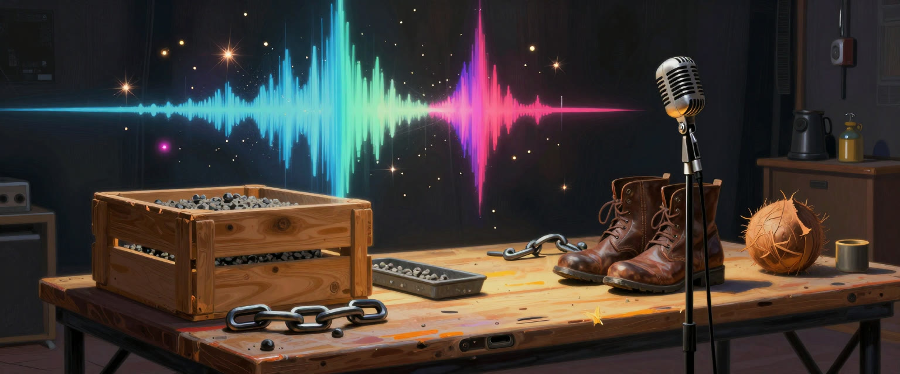

# sfxwright



Sound effects for games, films, video and apps, planned on disk, checked by measurement, with every file's source and licence kept beside it.

AI sound effects tend to fail in the same ways: a 3 second request returns 1.6 seconds and silence, one footstep gets machine-gunned, a loop clicks, and six months later nobody can say whether a file may ship. sfxwright is a skill for AI coding agents, plus a small standard-library script, that handles those parts. Your ear still decides what sounds good.

## What you get

- **A sound list.** A brief, shot list or game event list becomes `sounds.json`: event, layers, variations, length, format, route and status. Other plugins read that file.
- **Sounds with no model.** `sfx.py synth` renders footsteps, struck objects, UI clicks, wind, fire, explosions, creaks and retro sounds. No GPU, no download, no licence question.
- **Your ComfyUI, if you have one.** `sfx.py gen` reads what a server offers and runs Stable Audio 3 or Stable Audio Open. With no server it writes the workflow to hand over.
- **Edits by script.** Trim, fade, pitch, stretch, reverse, convolve, layer, variation sets, footstep sequences, seamless loops, placing on a timeline by sync point.
- **Measured checks.**

| command | question |
|---|---|
| `sfx.py check` | Clipping, DC, cut ends, clicks, padding, noise floor, length against the brief, loop seam |
| `sfx.py set` | Are these variations near-duplicates? Is one an outlier? Do levels match? |
| `sfx.py timing` | Is this sequence too even, or one sample repeating? |
| `sfx.py degrade` | Plant a known fault, to prove the checks catch it |
| `sfx.py ship` | Can this project ship these sounds? BLOCKED, CHECK or CLEAR, with reasons |
| `sfx.py doc` | Cue sheet, game implementation sheet, or credits and licences |

A flag means listen. It is not a verdict, and a clean result does not mean a sound is good.

- **Provenance that survives edits.** Model, prompt, seed, library, licence and every processing step travel with each file. A no-derivatives source refuses edits. An unknown licence blocks a commercial project.
- **Copies declined.** It will not recreate a named film's sounds or a famous sound mark, and offers an original built from acoustic traits.

## Install

```
claude plugin marketplace add m4bwav/sfxwright
claude plugin install sfxwright@sfxwright
```

The script needs Python 3.9 or later and nothing else. ffmpeg adds non-WAV input, stretch, convolution and OGG or FLAC delivery. Other agents can read `skills/sfxwright/SKILL.md` and run the script directly.

## Try it

```
cd skills/sfxwright/scripts
python sfx.py synth footstep --param surface=gravel --takes 6 --out takes --name step
python sfx.py set takes/step_*.wav
python sfx.py sequence takes/step_*.wav --out walk.wav --count 12
python sfx.py timing walk.wav
```

## How far to trust it

Defaults rest on one blind listen by one person: Stable Audio 3 Medium won 10 of 12 sounds, procedural recipes 2 (laser, campfire), Small SFX none. Other routes are reading and inference, and say so. The checks were tested with planted faults on a small set of sounds: DC, cuts and padding are caught reliably, while clicks under a loud sound and low noise often are not. The numbers are in [thresholds.md](skills/sfxwright/references/thresholds.md). `ship` keeps a record and is not legal advice.

## Works with

Each partner is optional. sfxwright works on its own, and every pairing goes through files on disk, not imports.

- [musicwright](https://github.com/m4bwav/musicwright): anything with notes, key or tempo goes to musicwright, and single hits and non-musical stings stay here. Its `mw.py` seam and master steps finish a loop or a cue. You get one sound world without either plugin guessing at the other's job.
- [voicewright](https://github.com/m4bwav/voicewright): dialogue and its room tone go there. Effects and voices end up in separate files, so a mix can move one without the other.
- [cinewright](https://github.com/m4bwav/cinewright): a shot list becomes a sound list, and cinewright reads `sounds.json` back when it cuts the film. Sound gets planned per shot instead of patched in at the end.
- [askwright](https://github.com/m4bwav/askwright): picks go on a blind, level-matched listening page. Numbers catch clicks and clipping, but only a listen tells you whether a sound suits its picture.
- [grindwright](https://github.com/m4bwav/grindwright): in a long game or film project, the sound lane stays open while sfxwright is installed, so sounds get made between other jobs instead of all at the end.
- [everscout](https://github.com/m4bwav/everscout): the `ai-sfx` beat brings in new models and licence news, so refreshes start from leads instead of a cold search.

More on the wiki's [Works with](https://github.com/m4bwav/sfxwright/wiki/Works-With) page.
